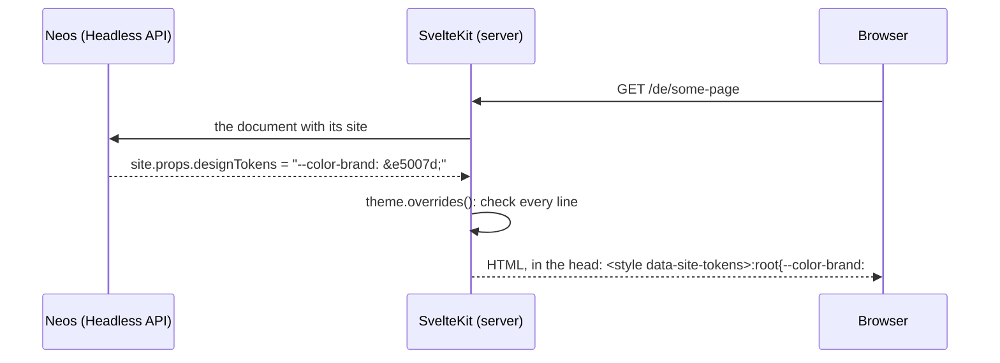

# How the SvelteKit adapter works

The styleguide in the Neos content module ([Devclaim.NeosStyleguide](https://github.com/Devclaim/Devclaim.NeosStyleguide))
knows nothing about the frontend: it asks an adapter for the components, the design tokens and the previews (its
PROTOCOL.md). This package is that adapter for SvelteKit. The core's ARCHITECTURE.md explains the parts that are the
same for every frontend (where a site's tokens are stored, the draft, the interface); this file the SvelteKit side.

The examples are from the Neos + SvelteKit base distribution, where the app lives in `Frontend/`.

## The parts

| Part | Where | Job |
| --- | --- | --- |
| Theme | the app's stylesheets, e.g. `src/lib/design/styles/*.css` | defines every token with its default, in `@theme` blocks (Tailwind); the only list of tokens |
| Tokens | `tokens.ts` (`themeTokens`), the app passes its stylesheets in | reads the tokens from that CSS; checks the overrides of a site, turns them into CSS |
| Site layout | the app, e.g. `routes/(site)/+layout.server.ts`, `+layout.svelte` | writes the overrides of the site into the `<head>` of each page |
| Catalogue | `<Component>.styleguide.yaml` next to the components, `catalogue.ts` | describes the components for the styleguide (props, use cases, examples) |
| Adapter | `server.ts` (`createStyleguide`), `adapter.ts` | answers the styleguide protocol: entries, tokens, previews |
| Configuration | the app, e.g. `src/lib/styleguide/styleguide.server.ts` | where the entries are, YAML tags, the site, the components for pages |

## 1. The theme: the CSS is the source

The tokens are CSS custom properties in the `@theme` blocks of the app's stylesheets:

```css
@theme static {
    /* Group: Semantic colors - the only colors components use */
    --color-brand: var(--color-sd-50); /* primary actions (buttons) */
    --color-brand-hover: var(--color-sd-60);
}
```

- **Tailwind turns them into utilities.** `--color-brand` gives `bg-brand`, `text-brand`, `border-brand` …, and the
    utilities do not contain the value but the variable: `.bg-brand { background-color: var(--color-brand) }`. So
    changing the variable changes every element that uses the utility, without building the CSS again.
- **`static`** makes Tailwind write every token to `:root`, also the ones no utility uses, so an override can refer to
    any token (`var(--color-oc-10)`). Costs about 0.6 kB gzip.
- **Two layers of colors.** The scales (`--color-sd-10` … `--color-sd-100`) are the palette; the semantic tokens
    (`--color-surface`, `--color-text`, `--color-brand` …) map the palette to a purpose. Components only use the
    semantic tokens. A site that changes `--color-brand` changes every button, link and highlight that means "brand",
    and nothing else.
- **Comments are data.** A comment `/* Group: <label> - <description> */` starts a group (other comment lines are only
    for developers); the comment behind a token is its description. Both are for developers: the adapter delivers
    them, the styleguide does not show them.
- **Build time tokens.** `--breakpoint-*` and `--container-*` end up in media queries. A media query cannot use a
    custom property, so these are fixed when the CSS is built; a site cannot change them (`BUILD_TIME_TOKEN`).

## 2. From Neos to the page

The app reads the tokens once, from the source of its stylesheets:

```ts
import { themeTokens } from '@devclaim/neos-styleguide-adapter-svelte';
import styles from './styles/Styles.css?raw';

export const theme = themeTokens([styles]);
```

How the tokens of a site get into the HTML of its pages (in the base distribution):



1. **Delivered with the page.** The app's API delivers the property `designTokens` of the site node (the core's
    mixin) with the page; in the content module with the session of the editor, so the workspace is used.
2. **Checked.** `theme.overrides(designTokens)` takes a line only if
    - the token exists in the theme,
    - it is not a build time token,
    - the value cannot leave the declaration (no `;`, `{}`, `<>`, `\`, `@`, comments, `url()`, at most 300
        characters),
    - and `var()` only refers to known tokens.

    Lines that are left out come back in `ignored` (the base distribution logs them in the dev server). The same rules
    check the styleguide's draft (`theme.rejection`, `POST …/tokens/validate`), so the editor sees why a value is not
    taken.
3. **Written into the head.** `<style data-site-tokens>:root{…}</style>` after the stylesheet and outside its cascade
    layers, so it wins over the defaults. Because the utilities use the variables (1.), this one rule restyles the
    page. (Not written in a `.svelte` file: vite-plugin-svelte's dev server edits the last `</style>` of a
    component's source.)
4. **Cache.** Publishing the site node has to purge the pages of the site, like any change of it (in the base
    distribution: the Neos cache tags of the page cache).

## 3. How the styleguide reads the theme

The interface asks `GET <basePath>/api/v1/tokens`; `tokens()` in `adapter.ts` answers:

1. `parseThemeTokens()` (`tokens.ts`) goes through the `@theme` blocks, statement by statement: a `Group:` comment sets
    the current group, a declaration becomes a token with its name, default value and description. The order of the
    CSS is kept. (The stylesheets are imported with `?raw`: Vite bundles the source of the file, not the compiled
    CSS.)
2. The adapter adds what the interface needs to show and edit a token: the group as an id (`semantic-colors`) with its
    label, description and kind (Farben, Schrift, Abstände und Größen, Schatten, Formate, Raster: the navigation of the
    tokens, by the names of a group's tokens), a type from the name (`--color-*` color, `--font-*` font,
    `--text-size-*`, `--spacing-*` … size, `--shadow-*`, `--aspect-*`, `--breakpoint-*`), and `editable: false` for
    build time tokens.

Nothing has to be registered: a new token in a `@theme` block appears in the styleguide with the next request (in
development) or the next build.

## 4. How the styleguide reads the components

### The catalogue

A component is in the styleguide when a YAML file sits next to it: `src/lib/ui/Button.svelte` →
`src/lib/ui/Button.styleguide.yaml`. The app finds them with a glob and passes them in (`sources`), and the module
paths of its components (`components`):

```ts
sources: import.meta.glob<string>('/src/lib/**/*.styleguide.yaml', { query: '?raw', import: 'default', eager: true }),
components: Object.keys(import.meta.glob('/src/lib/**/*.svelte')),
```

- **Id:** the path below `root` (`/src/lib/`) with dots: `ui.Button`, `content.Accordion`.
- **Level:** `level` in the file, one of the levels of the app's settings (`structure` of its `styleguide.yaml`,
    e.g. Atome, Moleküle, Organismen, Seiten); they are the navigation of the styleguide.
- **What is rendered:** `<Component>.styleguide.svelte` if there is one (a wrapper, e.g. a list with items), otherwise
    `<Component>.svelte`. The preview page loads the components with a second glob (`withComponents`), only when a
    preview needs them.
- **A broken file** is left out and logged; the others stay.

What a file can say (the full list is `Entry` in `catalogue.ts`):

| Field | Meaning |
| --- | --- |
| `title` | shown in the styleguide |
| `description` | for developers; delivered by the adapter, not shown |
| `props` | the defaults of the props; text, numbers and booleans get an editor in the props inspector |
| `editors` | an editor for a prop that cannot be guessed (`select` with `options`, `textarea`) |
| `propSets`, `useCases` | named sets of props on top of the defaults ("Icon only", "two columns") |
| `node` | a content element: the props are the properties of a node of that Neos node type |
| `children`, `parent` | child nodes (the items of an accordion), or the element it only exists in (rendered with the app's `contentList`) |
| `document`, `collections` | a page: the node type of the document and its content collections (elements of the styleguide or nodes, `all`), rendered with the app's `page`; tethered nodes like the hero are props written like an item |
| `tethered` | only a tethered node of a document (the hero): not in the list of all content elements |
| `frame`, `width` | how the preview frames it: padded, on the page grid, full screen; a maximum width of the content |
| `data` | `site`: the site from the app's `site()` (navigation, footer), for the header and footer |

Every example is in the YAML, none comes from the content of a site. The app adds YAML tags for its data (`tags`), e.g.
`!image 1600x900` for a placeholder image: an image whose asset id is `dummyAsset(1600, 900)`, whose variants
`<basePath>/image` draws.

### The adapter

| Request | Answer |
| --- | --- |
| `GET <basePath>/api/v1/manifest` | levels, viewports, the URL template of the preview, the features of the preview |
| `GET …/entries` | every entry: id, title, level, description, use cases, prop sets, its YAML file |
| `GET …/entries/{id}` | one entry with its props and their editors (configured, or guessed from the default) |
| `GET …/tokens`, `POST …/tokens/validate` | see 3. and 2. |

All of it needs a backend session: the adapter asks the core's Neos API (`GET /api/styleguide/v1/sites`) with the
editor's cookie (the app's `handleFetch` passes it on); without one it answers `401`.

### The preview

The interface shows an entry in an iframe: `<basePath>/preview?entry=ui.Button&site=nudelsuppe` (plus `useCase`,
`propSet`, `props`). `preview()` in `server.ts`:

1. finds the entry, and the site through the core's Neos API (its tokens in the editor's workspace and its
    languages);
2. puts the props together: defaults, then prop set, then use case, then the props changed in the inspector;
3. builds what the component gets (`componentProps()`): a content element gets a node built from the YAML (with
    its children), a page its content collections and the site, entries with `data: site` the site.

The app's page renders it with `Previews.svelte`, every entry in its frame (the app's classes: padding, page grid)
inside `data-styleguide-root`, with the site's tokens in the head, so it looks exactly like on the website; it draws
the page grid of the website while `<html>` has `data-styleguide-grid`.

With `?entries=<id>,<id>,…` the same route is the gallery: every entry with its defaults, each in
`data-styleguide-entry`. Whole pages (`document`) and full screen entries are only shown alone (`gallery: false`); a page
is `page: true`, the interface scrolls it inside its frame.

That is all the frontend does: the preview is a plain page. The interface works on it itself: it puts the draft into
its head, sizes the iframe to the bottom of the root element, reads the tokens the entry uses and sets the grid
attribute.

## 5. Recipes

- **A new token:** add it to a `@theme` block, under the right `Group:` comment, with a comment behind it if it needs
    an explanation. Tailwind makes the utilities, the styleguide shows it, sites can change it.
- **A new group:** a comment `/* Group: <label> - <description> */` in a `@theme` block; the tokens below it belong to
    it.
- **A component in the styleguide:** a `<Component>.styleguide.yaml` next to it with `title`, `level` and `props`; for
    a content element `node` and `frame: page-grid`. Optionally a `<Component>.styleguide.svelte` that wraps it.
- **Checking the adapter:** the base distribution's `Benchmarks/browser/styleguide-protocol.mjs <origin>` (the
    protocol) and `styleguide.mjs <origin>` (the whole styleguide in the content module).
